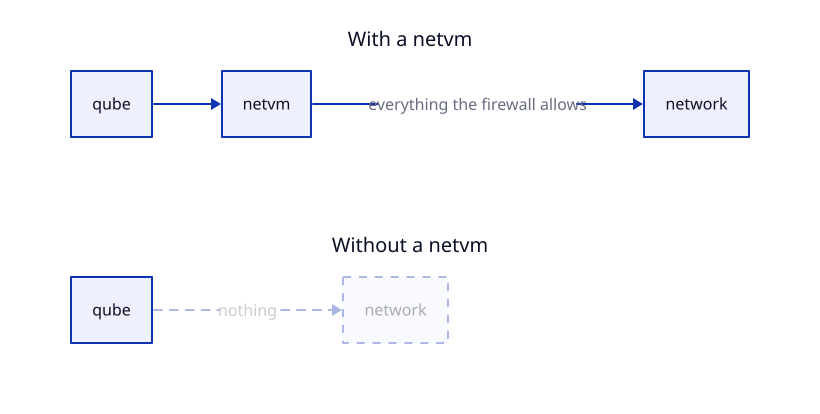
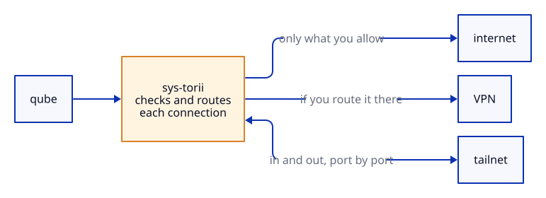
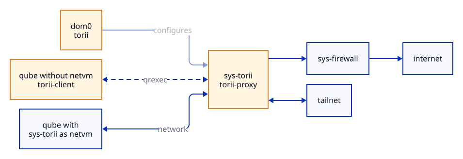
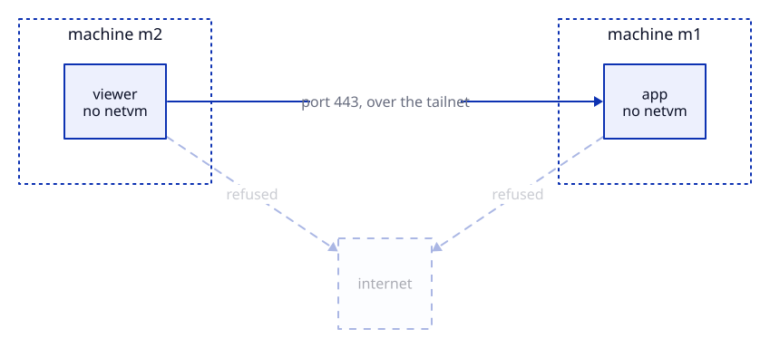

# torii

torii controls what each qube can connect to, what can connect to it, and
which way its traffic goes, for example through a VPN.

You write the rules for all your qubes in one file in dom0. torii sets up
Qubes to match that file and runs a proxy qube that applies it to every
connection.

> **Experimental.** The file format, commands and names may change between
> versions without a migration path. torii changes dom0 policy and your
> qubes' networking, so try it on a machine you can rebuild. It is an
> independent project, not part of or endorsed by the Qubes OS Project.

## Why

Qubes controls each qube's network access through its netvm. A qube either
has a netvm or it doesn't. With one, it has a full network stack, and the
Qubes firewall limits what it can reach by IP address. Without one, it has no
network at all.



Most qubes need something in between: a few connections in, a few out, maybe
a particular route. Today the only way to get that is to give the qube a
netvm and block everything else with rules. Those rules end up spread across
netvms, firewall settings, qrexec policy and hand-written nftables, and
nothing shows you what they add up to.

torii fills that gap. You describe what each qube may connect to, in both
directions, in one file. torii configures Qubes to match, decides and routes
each connection as it happens, and shows you what every qube can actually
reach. A qube that needs only a few connections can have them without a
netvm.



## What it does

**Decides each connection**

- Internet access is allowed by name, like `pypi.org` or
  `*.example.com:443`. A connection goes through only if the qube looked up
  an allowed name, and for TLS, only if the server name matches too. An
  address the qube never looked up is refused.
  ([Limits](docs/design.md#limits))
- Inbound connections reach only the ports you list.
- Qubes on the same machine can reach each other's ports when you allow it.
- Qubes you haven't listed, including disposables, get nothing unless you
  say otherwise.

**Routes it**

- Each qube can keep its usual netvm, sit behind the proxy qube, or have no
  netvm at all.
- Each proxy qube can sit in front of any netvm, such as your own VPN qube.
- Internet traffic can go through exit nodes, tried in order. If none of them
  is up, connections fail instead of going out directly.

**Gives each qube its own identity**

- On a Tailscale or Headscale network, each qube can be its own device with
  its own tags, so the network's access rules apply per qube instead of per
  machine.
- New devices join through a sign-in link that you approve. dom0 never holds
  keys.

**Shows you the result**

- `torii show` reads back from the live system what each qube can reach.
- `torii check` lists where the system differs from your file.
- `torii log` shows why each connection was allowed or refused.

## How it works



torii has three parts:

- **`torii`, in dom0.** A small Python tool. It reads your file, works out
  the changes, and makes them through the Qubes Admin API: each qube's
  netvm, a qrexec policy file, and the proxy qube itself. It never touches
  network traffic.
- **`torii-proxy`, in the `sys-torii` qube.** A Go program that checks,
  routes and logs every connection. The qube's kernel doesn't forward
  packets, so nothing gets through unless the program passes it on.
- **`torii-client`, in qubes without a netvm.** It gives programs in the qube
  an HTTP proxy, a SOCKS proxy and fixed port forwards on `localhost`. Each
  connection becomes a qrexec call to `sys-torii`, which dom0 allows for that
  qube only.

[`docs/design.md`](docs/design.md) explains why it's built this way.

## Common setups

Each example shows qube entries under `qubes:` in your file.
[`docs/setup.md`](docs/setup.md#9-add-the-other-patterns) has more.

**A server and a client on two machines, sealed off from everything else**



On the first machine (`m1`), the server:

```yaml
app:
  network: none
  tailnet: { identity: tagged, inbound: [443] }
```

On the second machine (`m2`), the client:

```yaml
viewer:
  network: none
  outbound: { tailnet: [m1-app:443] }
  tailnet: { identity: tagged }
```

`viewer` can reach `app` on port 443 and nothing else, and `app` can't open
connections at all. Neither qube has a netvm or internet access. If `app` is
compromised and serves `viewer` a malicious web app, that code can only talk
back to `app`, and `app` has no way to send anything on. In your tailnet's
access rules, grant only `viewer` access to `app`.

**A service reachable from your tailnet, with no netvm**

```yaml
wiki:
  network: none
  tailnet: { identity: tagged, inbound: [{ port: 443, target: 8443 }] }
```

`wiki` joins your tailnet as its own device. Port 443 reaches the qube's
port 8443, and nothing else reaches it at all.

**A build qube that can only fetch packages**

```yaml
build:
  network: none
  outbound: { internet: [pypi.org, files.pythonhosted.org] }
```

Programs in `build` use the HTTP proxy torii sets up inside the qube.
Requests to PyPI go through, and everything else is refused. No tailnet
needed.

**A browser whose traffic goes through exit nodes**

```yaml
egress:
  vpn: { exits: [exit-home, exit-cloud] }

qubes:
  browser:
    network: proxy
    egress: vpn
    outbound: { internet: all }
```

`browser` reaches the whole internet, but only through the first exit node
that's up. If neither is up, connections fail instead of going out directly.

## Try it

You need a Qubes 4.3 machine and a qube with network access to build in,
with `git`, `make` and Go 1.21 or newer. A Tailscale or Headscale tailnet is
optional; you need one only for per-qube identities and exit nodes.
[`docs/setup.md`](docs/setup.md) walks through every step with the output to
expect.

**1. Build** the package in your build qube (here `dev`):

```sh
git clone https://github.com/leroux/torii-qubes.git && cd torii-qubes
make
```

This produces a single RPM that contains everything.

**2. Install** it in dom0:

```sh
qvm-run --pass-io dev 'cat ~/torii-qubes/build/torii-dom0-*.noarch.rpm' > /tmp/torii.rpm
sudo dnf install /tmp/torii.rpm
```

**3. Write `~/torii.yaml`** in dom0. Start from
[`examples/machine.yaml`](examples/machine.yaml) or one of the setups above.
The qubes must already exist. torii changes only their network settings, and
never creates or deletes your qubes.

**4. Plan, then apply:**

```sh
torii plan     # shows every change, in order
torii apply    # makes them; the first run also creates sys-torii
```

Qubes without a netvm that reach out also need the client in their template.
`torii plan` tells you which templates lack it, and
`torii install-client TEMPLATE` adds it.

**5. Connect to your tailnet** (only if you use tailnet identities). Add your
tags to the tailnet policy ([how](docs/tailscale.md#tags)). Then run
`torii show`, which prints a sign-in link for each new identity, and approve
each link. Finally, run `torii grants` to get suggested access rules for the
tailnet policy. A port your file opens but no rule allows is never reached.

## Everyday commands

| Command | What it does |
|---|---|
| `torii plan` | Shows every change `apply` would make, in order |
| `torii apply` | Makes the changes. If it stops partway, run it again to continue. |
| `torii show [QUBE]` | What each qube can reach, read from the live system |
| `torii check` | Where the live system differs from your file |
| `torii log QUBE` | Recent connections to and from a qube, and why each was allowed or refused |

Every command reads `~/torii.yaml` unless you pass `-f FILE`. The full list,
including `grants`, `install-client` and `snapshot`, is in
[`docs/setup.md`](docs/setup.md#commands).

## Learn more

Every doc, who it is for and the order to read them in:
[`docs/README.md`](docs/README.md). The main ones:

| | |
|---|---|
| [`docs/setup.md`](docs/setup.md) | Setting up a machine step by step, then each pattern; every command and file key |
| [`docs/tailscale.md`](docs/tailscale.md) | The tailnet side: tags, grants, HTTPS, sign-in, exit nodes, Headscale |
| [`docs/architecture.md`](docs/architecture.md) | The parts, what runs where, and what crosses each boundary |
| [`docs/design.md`](docs/design.md) | The problem, the model, why it's built this way, and its limits |
| [`docs/testing.md`](docs/testing.md) · [`docs/performance.md`](docs/performance.md) | How it's tested, and how fast it is |
| [`docs/salt.md`](docs/salt.md) | Configuring many machines from Salt |
| [`HACKING.md`](HACKING.md) · [`proxy/README.md`](proxy/README.md) | Working on the code |

## Status

Experimental. Tested end to end on Qubes 4.3 with a Fedora 44 proxy template
and Fedora 43 qubes, against Tailscale and Headscale. Qubes 4.2 should work
but hasn't been tested. Some features haven't been tried on a real machine
yet; [`TODO.md`](TODO.md) lists them. Known limits are in
[`docs/design.md`](docs/design.md#limits).

## License

MIT, see [`LICENSE`](LICENSE).
