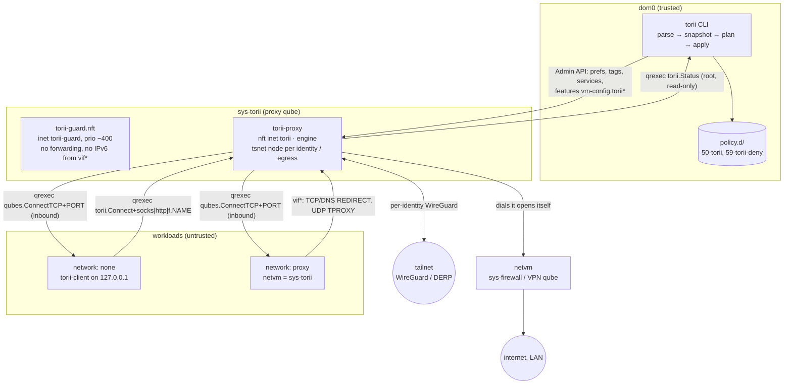

# Architecture

The components of torii, where each runs, the interfaces between them,
and the trust each interface relies on. The rationale is in
[`design.md`](design.md); the data paths are traced through the code in
[`walkthrough-connection.md`](walkthrough-connection.md),
[`walkthrough-apply.md`](walkthrough-apply.md) and
[`walkthrough-egress.md`](walkthrough-egress.md). The decisions each
component carries are entries in `claims/`, named in each section.

## Overview



## Trust model

From [`claims/needs.md`](../claims/needs.md): dom0 and the owner who
writes the machine file are trusted; the tailnet's coordination server is
trusted for membership, and its grants are the owner's; code in every
other qube, and every remote host, may be hostile.

The trusted computing base for confinement of a workload is therefore:
dom0's qrexec policy and the torii tool that writes it; Qubes' own
mechanisms the design leans on (qrexec caller naming, `vif*`
anti-spoofing, QubesDB's dom0-only write path for features); and, in the
proxy qube, the kernel, the guard ruleset and `torii-proxy`. The proxy
qube is netvm-equivalent: compromising it yields every identity it holds
and the plaintext of what it relays, which [STK-261126-SM33](../claims/needs.md#stk-261126-sm33-torii-adds-no-qrexec-call-network-path-or-dom0-exposure-beyond-those-the-file-declares) accepts
and bounds; a workload that must not share that exposure gets a
dedicated proxy (`proxies:`).

## dom0: the `torii` tool

A Python package, `dom0/torii`, installed from the dom0 RPM; it uses
`qubesadmin` for the Admin API and `qrexec.policy.admin_client` for policy
files, and has no network access (dom0 has none).

| Module | Role | Main declarations |
|---|---|---|
| [machine.py](../dom0/torii/machine.py) | parse and validate the machine file, whole or not at all ([SW-261127-9BNW](../claims/apply.md#sw-261127-9bnw-the-machine-file-is-read-whole-and-refused-whole-when-a-key-a-network-or-a-value-is-wrong)) | [`machine.parse`](../dom0/torii/machine.py#L551), [`tags_of`](../dom0/torii/machine.py#L25) |
| [live.py](../dom0/torii/live.py) | read the machine into a serializable snapshot | [`live.take`](../dom0/torii/live.py#L83), [`Snapshot`](../dom0/torii/live.py#L44) |
| [derive.py](../dom0/torii/derive.py) | the desired state: proxy configs, workload state, policy text, grants | [`derive.proxy_config`](../dom0/torii/derive.py#L53), [`derive.qube_state`](../dom0/torii/derive.py#L192), [`derive.policy`](../dom0/torii/derive.py#L216), [`derive.grants`](../dom0/torii/derive.py#L261), [`derive.encode_chunks`](../dom0/torii/derive.py#L135) |
| [plan.py](../dom0/torii/plan.py) | pure diff of desired against snapshot into ordered steps ([SW-261127-2JH3](../claims/apply.md#sw-261127-2jh3-plan-refuses-before-any-step-a-file-that-names-what-this-machine-cannot-be-given), [SW-261127-G26T](../claims/apply.md#sw-261127-g26t-apply-changes-only-what-torii-owns-its-template-its-proxy-qubes-its-policy-files-and-named-workload-settings)) | [`plan.make`](../dom0/torii/plan.py#L96), [`plan.notes`](../dom0/torii/plan.py#L316) |
| [apply.py](../dom0/torii/apply.py) | execute steps one at a time, stop at the first failure ([SW-261127-63CS](../claims/apply.md#sw-261127-63cs-apply-makes-the-plans-steps-in-order-stops-at-the-first-that-fails-and-a-second-run-continues)) | [`Applier.run`](../dom0/torii/apply.py#L45) |
| [show.py](../dom0/torii/show.py), [status.py](../dom0/torii/status.py) | reach from the live machine; drift; proxy status over qrexec | [`show.qube_view`](../dom0/torii/show.py#L97), [`show.check_problems`](../dom0/torii/show.py#L365), [`status.read`](../dom0/torii/status.py#L13) |
| [cli.py](../dom0/torii/cli.py) | the commands | [`cli.main`](../dom0/torii/cli.py#L297) |

The only qube-originated data dom0 parses is `torii.Status` output, as
JSON. dom0 relays no traffic and holds no tailnet credential: an auth key
given to `torii sign-in-key` is piped to the proxy qube and stored there
([SW-261127-3TPX](../claims/identity.md#sw-261127-3tpx-an-identity-signs-in-by-a-link-a-person-approves-or-a-one-time-key-that-only-the-proxy-qube-keeps)).

## Template and packages

The dom0 RPM (`packaging/dom0`) carries the proxy and client packages
(`packaging/proxy`, `packaging/client`) as `.deb` and `.rpm` under
`/usr/share/torii`. On first apply the tool clones the base template
(`fedora-44-minimal` by default) to its own (`torii-fedora-44-minimal`,
tagged `torii-owned`) and installs the proxy package from the bundle as
root over `qubes.VMRootShell`, its dependencies coming from the
template's distribution repositories
([`Applier.do_template_package`](../dom0/torii/apply.py#L126),
[SW-261127-HSHY](../claims/apply.md#sw-261127-hshy-the-proxy-package-comes-from-the-dom0-packages-bundle-with-no-repository-for-torii)). No template is configured with a repository for
torii. The client package is installed into a workload's template only by
`torii install-client TEMPLATE`, and is inert where dom0 has not enabled
the `torii-client` service.

## The proxy qube

An AppVM on the tool's template with `provides_network`, `autostart`, the
`torii-proxy` service enabled and the Qubes `ipv6` feature set empty
(false) so that neither it nor its clients get IPv6 from Qubes
([SW-261127-3Q23](../claims/apply.md#sw-261127-3q23-every-proxy-qube-has-ipv6-off-for-itself-and-every-qube-behind-it)). Its netvm is `sys-firewall` unless the file names
another.

### Boot ordering and the guard

[`torii-guard.service`](../packaging/proxy/torii-guard.service) is a
`oneshot` with `DefaultDependencies=no`, ordered after `local-fs.target`
and before `network-pre.target`, `qubes-network.service`,
`qubes-network-uplink.service` and `torii-proxy.service`, wanted by
`sysinit.target` in every qube of the template. It loads
[`torii-guard.nft`](../packaging/proxy/torii-guard.nft):
`table inet torii-guard` with base chains at priority −400 that drop
every forwarded packet, drop IPv6 from `vif*` at prerouting, drop and log
any packet with an input interface reaching postrouting (the `tripwire`
counter, which must stay 0), and drop the qube's own connections to
`10.137.0.0/16` and `10.138.0.0/16`. A drop in a base chain is final, so
no later table can re-accept. The drop-in
[`qubes-network-requires-guard.conf`](../packaging/proxy/qubes-network-requires-guard.conf),
installed as `qubes-network.service.d/torii-guard.conf`, makes Qubes'
forwarding setup `Requires=` the guard, so a guard that fails to load
leaves the qube without forwarding rather than unguarded.

<!-- charter:embed SW-261127-JWK2 -->
> **[SW-261127-JWK2](../claims/links.md#sw-261127-jwk2-a-guard-loaded-at-boot-keeps-the-proxy-qube-forwarding-nothing-whatever-the-program-does) A guard loaded at boot keeps the proxy qube forwarding nothing, whatever the program does**
>
> Every qube of the proxy template loads a guard ruleset at boot, before
> Qubes sets up its network; if the guard fails to load, neither Qubes'
> network service, which turns forwarding on, nor the program starts. The
> program's rules are a table of their own and never touch the guard. In
> base chains at priority -400 the guard drops every forwarded packet,
> and any packet about to leave with an input interface other than IPv6
> link-local and multicast control traffic (counted and logged as a
> tripwire); drops IPv6 arriving from `vif` interfaces; and drops the
> proxy qube's own connections to other qubes' Qubes addresses.
<!-- /charter:embed -->

Known gap, recorded in TODO.md: `qubes-network-uplink.service` is only
ordered after the guard, not `Requires=` it, so a failed guard still
leaves the proxy qube its own uplink.

### `torii-proxy`

[`torii-proxy.service`](../packaging/proxy/torii-proxy.service) runs
`torii-proxy run -config qubesdb:torii -install-rules -downstream vif*`
when `/run/qubes-service/torii-proxy` exists, `Requires=` the guard, sets
`nf_conntrack_max` to 65536 first, and restarts on exit.

**Configuration.** Read from QubesDB `/vm-config/torii` and its parts,
which dom0 writes as features and the qube cannot change at the source.
[`qubesdb.Config`](../proxy/internal/qubesdb/qubesdb.go#L42) reassembles and
verifies the SHA-256; [`run`](../proxy/cmd/torii-proxy/main.go#L89) refuses
to start on an invalid config and
[`waitForNewConfig`](../proxy/cmd/torii-proxy/main.go#L165) never replaces a
running one with an invalid one: [SW-261127-XGDY](../claims/apply.md#sw-261127-xgdy-a-proxy-takes-its-config-whole-or-not-at-all-and-a-failed-check-never-replaces-the-running-one).

**Identities.** [`daemon.Identities`](../proxy/internal/daemon/daemon.go#L61)
creates one [`TSNet`](../proxy/internal/tailnet/tsnet.go#L38) (a
`tsnet.Server` with its own userspace WireGuard and gVisor netstack) per
workload identity, per service and per egress, each with its own state
directory under `/rw/torii/state/` on the qube's private volume:
[SW-261127-WNGN](../claims/identity.md#sw-261127-wngn-each-identity-is-a-tailnet-device-of-its-own-with-its-own-name-and-state). One-time auth keys live under `/rw/torii/keys/`.
Client log upload to `log.tailscale.com` is off unless the file asks, and
the port mapper (UPnP, NAT-PMP, PCP) is always off ([SW-261127-8PTP](../claims/identity.md#sw-261127-8ptp-an-identity-sends-tailscale-no-client-logs-unless-the-file-asks-and-never-maps-ports)).

**Listeners**, opened by [`daemon.Start`](../proxy/internal/daemon/daemon.go#L116):

| Listener | Default | Who reaches it |
|---|---|---|
| connect socket | `/run/torii/connect.sock`, mode 0666 | `torii.Connect` calls from qrexec workloads |
| intercept | `0.0.0.0:15001` TCP | routed workloads, via `REDIRECT` |
| DNS | `0.0.0.0:15053` UDP and TCP | routed workloads, via `REDIRECT` |
| UDP | `0.0.0.0:15002`, transparent | routed workloads' non-DNS IPv4 UDP, via `TPROXY` mark `0x7173` |
| local SOCKS | `127.0.0.1:1080` | programs in the proxy qube itself (the `link: none` workload) |
| per identity | declared inbound ports, in the identity's netstack | tailnet peers the grants allow |
| admin | `/run/torii/admin.sock`, mode 0600 | `torii.Status` and the `status`, `log`, `explain` subcommands |

The interception table, `table inet torii`, is loaded by
[`intercept.Install`](../proxy/internal/intercept/intercept.go#L74), which
also writes 0 to the IPv4 and IPv6 forwarding sysctls and adds its accepts
to Qubes' `ip qubes custom-input` chain
([`QubesInputRules`](../proxy/internal/intercept/intercept.go#L353)), since
Qubes' own input chain would otherwise reject traffic from downstream to
the netvm: [SW-261127-B6Z6](../claims/links.md#sw-261127-b6z6-a-routed-qubes-traffic-reaches-the-program-and-nothing-else-interception-with-forwarding-off).

**Decision engine.** One [`Engine`](../proxy/internal/engine/engine.go#L87),
entered by the transport that delivered the connection:
[`Engine.HandleQrexec`](../proxy/internal/engine/engine.go#L534),
[`Engine.HandleIntercepted`](../proxy/internal/engine/engine.go#L779),
[`Engine.AnswerDNS`](../proxy/internal/engine/engine.go#L807),
[`Engine.HandleUDP`](../proxy/internal/engine/udp.go#L69), and the inbound
listeners started by [`Engine.Start`](../proxy/internal/engine/engine.go#L286).
The authorization rules are pure functions in `internal/policy`
([`DecideOutbound`](../proxy/internal/policy/policy.go#L131),
[`DecideInbound`](../proxy/internal/policy/policy.go#L290),
[`ZoneOf`](../proxy/internal/policy/zone.go#L44)), unit-tested without I/O.
Each egress has a [`Selector`](../proxy/internal/egress/egress.go#L92). Every
decision is an event in [`Log.Emit`](../proxy/internal/events/events.go#L61)
([SW-261127-R4CD](../claims/seeing.md#sw-261127-r4cd-every-connection-the-proxy-decides-is-logged-with-its-verdict-and-the-rule-that-made-it)), served with status and explain by
[`admin.Handler`](../proxy/internal/admin/admin.go#L23).

| Package | Responsibility | Area |
|---|---|---|
| `policy` | zones, allowlist matching, inbound ports; pure | [connections](../claims/connections.md) |
| `engine` | per-transport handling, dial, SNI-checked relay, UDP flows, explain, status | [connections](../claims/connections.md), [egress](../claims/egress.md) |
| `dnsx`, `sni`, `socks5` | DNS wire format and the per-workload name cache; ClientHello parsing; SOCKS5 `CONNECT` | [connections](../claims/connections.md) |
| `qrexec`, `intercept` | caller attribution and `qubes.ConnectTCP` dialing; nftables, `SO_ORIGINAL_DST`, TPROXY | [links](../claims/links.md) |
| `tailnet`, `egress` | tsnet identities, netstack dials, exit-node selection | [identity](../claims/identity.md), [egress](../claims/egress.md) |
| `config`, `qubesdb`, `daemon` | config schema and validation, QubesDB transport, process wiring | [apply](../claims/apply.md) |
| `events`, `admin` | decision log, admin HTTP over the unix socket | [seeing](../claims/seeing.md) |

### qrexec services

- [`torii.Connect`](../packaging/proxy/torii.Connect) execs
  `torii-proxy connect-service`,
  [`qrexec.ExecService`](../proxy/internal/qrexec/qrexec.go#L131): it writes the
  header `torii.Connect+<arg> <caller>\0` to the connect socket, the
  caller taken from `QREXEC_REMOTE_DOMAIN`, which dom0 sets; nothing the
  calling qube sends in-band names it ([SW-261127-7C3Y](../claims/links.md#sw-261127-7c3y-a-qrexec-caller-is-the-qube-dom0-names-never-one-the-caller-states)).
- [`torii.Status`](../packaging/proxy/torii.Status) execs `torii-proxy
  status-service`, [`statusService`](../proxy/cmd/torii-proxy/main.go),
  which issues two GETs on the admin socket and prints one JSON object;
  it reads no input and has no mutating endpoint behind it
  ([SW-261127-B8BM](../claims/seeing.md#sw-261127-b8bm-the-status-service-is-read-only-it-reports-and-changes-nothing-in-the-proxy)).

## Workloads

The link a workload uses is fixed by its `network:` ([`claims/links.md`](../claims/links.md)):

- **`network: none`, link `qrexec`.** No netvm, so no network interface.
  With outbound access declared, dom0 enables the `torii-client` service
  and writes `vm-config.torii-client` ([`derive.client_config`](../dom0/torii/derive.py#L169));
  the client listens on loopback only and makes one `torii.Connect` call
  per connection ([`listenAll`](../proxy/cmd/torii-client/main.go#L118),
  [SW-261127-N3N8](../claims/links.md#sw-261127-n3n8-in-a-qube-with-no-netvm-the-client-listens-on-loopback-only-one-qrexec-call-per-connection)). With none declared, it can make no qrexec call at
  all.
- **`network: proxy`, link `routed`.** netvm is the proxy qube. Its
  packets arrive on `vif*` and are attributed by source address,
  [`Config.ByAddress`](../proxy/internal/config/config.go#L523):
  [SW-261127-BHHX](../claims/links.md#sw-261127-bhhx-a-routed-qube-is-named-by-its-qubes-source-address-which-qubes-keeps-it-from-forging), resting on the observation
  [QubesAntispoof](../claims/observations.md#qubesantispoof). Only qubes
  with a fixed address can be routed workloads; a disposable cannot be
  listed.
- **`network: default` or a named netvm.** Not carried; torii sets only
  the netvm.
- **Attached but unlisted**, a disposable included: attributed as
  `unlisted:<address>` and decided by the proxy's `unlisted:` policy,
  `refuse` by default, never with a tailnet identity.

Inbound to either link is `qubes.ConnectTCP+<port>` from the proxy into
the workload; a routed workload gets the same call because a Qubes app
qube's firewall drops new connections from its netvm.

## qrexec policy

[`derive.policy`](../dom0/torii/derive.py#L216) renders
`/etc/qubes/policy.d/50-torii.policy` (`50-torii-<mesh>.policy` for a
named mesh):

```
qubes.ConnectTCP  +<port>  <proxy>   <workload>  allow          # inbound, per declared port
torii.Connect     +socks   <wl>      @default    allow target=<proxy>
torii.Connect     +socks   <wl>      <proxy>     allow          # likewise +http, +f.<name>
qubes.ConnectTCP  +<port>  <source>  <workload>  allow          # local-inbound
torii.Status      *        dom0      <proxy>     allow user=root
```

[`derive.deny_policy`](../dom0/torii/derive.py#L317) renders
`59-torii-deny.policy`, `torii.Connect` and `torii.Status` denied for
`@anyvm` to `@anyvm`, in its own file so that it sorts after every mesh's
allows (first match wins).

<!-- charter:embed SW-261127-M36P -->
> **[SW-261127-M36P](../claims/links.md#sw-261127-m36p-every-qrexec-call-runs-in-the-direction-of-the-connection-it-carries-and-only-the-declared-ones-are-allowed) Every qrexec call runs in the direction of the connection it carries, and only the declared ones are allowed**
>
> Outbound, a carried qube with no netvm calls `torii.Connect` in its own
> proxy, with `+socks`, `+http` or `+f.<forward>`, and only those its entry
> declares. Inbound, the proxy calls `qubes.ConnectTCP` into a carried qube,
> routed or not, only on the target ports its entry or a service lists.
> Between qubes on this machine, `qubes.ConnectTCP` is allowed only from the
> qubes `local-inbound` names, on its port. A qube that declares no
> outbound access is allowed no `torii.Connect` call, and calls
> `qubes.ConnectTCP` only where another qube's `local-inbound` names it.
> torii's deny file, read after every mesh's own, denies `torii.Connect`
> and `torii.Status` to every caller the allows do not name;
> `qubes.ConnectTCP` beyond them is left to Qubes' own policy (observation
> QubesConnectTCPDenied). A hand-written policy file read before torii's
> can widen any of these, and check names it (STK-261126-4Q75).
<!-- /charter:embed -->

The deny file does not mention `qubes.ConnectTCP`. That no qube can call
it into another without an allow line rests on Qubes' default policy,
the observation
[QubesConnectTCPDenied](../claims/observations.md#qubesconnecttcpdenied),
not yet confirmed by a probe. `torii check` names any other policy file
that grants `qubes.ConnectTCP` to or from a managed qube.

## Trust boundaries

| Boundary | What crosses | Authenticated by | Entry |
|---|---|---|---|
| workload → proxy, qrexec | a TCP stream and the service argument | dom0 names the caller; policy names the target | [SW-261127-7C3Y](../claims/links.md#sw-261127-7c3y-a-qrexec-caller-is-the-qube-dom0-names-never-one-the-caller-states) |
| workload → proxy, `vif*` | IPv4 packets | Qubes anti-spoofing on the source address | [SW-261127-BHHX](../claims/links.md#sw-261127-bhhx-a-routed-qube-is-named-by-its-qubes-source-address-which-qubes-keeps-it-from-forging) |
| proxy → workload | `qubes.ConnectTCP` to a declared port | dom0 policy, per port | [SW-261127-T7GG](../claims/connections.md#sw-261127-t7gg-an-inbound-connection-reaches-a-qube-only-on-a-port-its-entry-or-a-service-lists) |
| dom0 → proxy | config as features | dom0-only write path; SHA-256 over the parts | [SW-261127-XGDY](../claims/apply.md#sw-261127-xgdy-a-proxy-takes-its-config-whole-or-not-at-all-and-a-failed-check-never-replaces-the-running-one) |
| proxy → dom0 | status and log JSON | qrexec, as root, read-only service | [SW-261127-B8BM](../claims/seeing.md#sw-261127-b8bm-the-status-service-is-read-only-it-reports-and-changes-nothing-in-the-proxy) |
| proxy → netvm | connections the program opens | kernel forwarding off, guard at −400 | [SW-261127-B6Z6](../claims/links.md#sw-261127-b6z6-a-routed-qubes-traffic-reaches-the-program-and-nothing-else-interception-with-forwarding-off) |
| proxy ↔ tailnet | each identity's WireGuard traffic | node keys; the grants decide reach | [SW-261127-DH6R](../claims/identity.md#sw-261127-dh6r-torii-proposes-grants-for-the-tailnet-and-never-changes-its-policy) |
