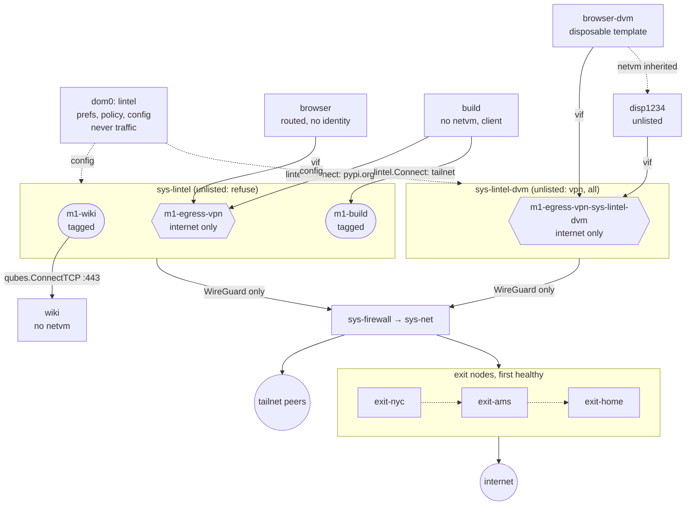

# Egress: exit nodes with failover, failing closed, without an identity per qube

Status: design, agreed in brainstorming on 2026-11-10. Not yet implemented.

## Summary

A qube's internet can be forced through Tailscale exit nodes: an ordered
list, with automatic failover and a delayed failback. If no exit node is
healthy, connections are refused; they never go direct. A qube that only needs
this (no tailnet access) gets no tailnet identity of its own: it uses the
egress's one shared, internet-only identity.

At the same time the file is restructured so each fact is written once, and
the dom0 tool is made safe to adopt gradually on an existing machine: it only
changes qubes named in the file, refuses risky adoptions unless told, and
anything leaving its control fails closed.

## Goals

- **Force internet through exit nodes, failing closed.** Threat model:
  *failures*: an exit node down, its uplink broken, the proxy crashed or
  reloading, a half-written config. The qube and the person at dom0 are
  trusted. Drift prevention and a compromised qube are out of scope, except
  where this spec adds a specific check.
- **Several exit nodes**, in order, with failover and failback after a
  hold-down.
- **No identity per qube** for qubes that only need the internet.
- **Easy to change**: one line in the file.
- **Gradual adoption**: every step affects only what it names. Never damage
  an existing Qubes setup.
- **Deny by default** at every layer, for paranoid users.
- **Room for a Little Snitch-style firewall** later, per qube, without
  redesign.

## Non-goals

- Shared *tailnet* identities (several qubes appearing as one tailnet device).
  The schema leaves room for an explicit `identities:` section later.
- Offline disposables (disposables using the client over qrexec), and
  per-disposable-template policy within one proxy.
- Migrating old machine files. Old keys fail with an error that says what to
  write instead.
- Preventing drift (netvms changed by hand); `check` reports it.
- Health probes to third parties by default.

## Concepts

Three separate things, each answering one question:

| | Answers | In the file |
|---|---|---|
| **Identity** | Who is this qube on the tailnet? | `tailnet:` |
| **Egress** | Which way does its internet go? | top-level `egress:`, chosen by the qube's `egress:` |
| **Policy** | What may it reach? | `outbound:` (later: `rules:`, `ask`) |

- **`sys-lintel`** is the one proxy qube. It holds every identity and every
  egress used by the qubes on it. **Extra proxies** (`proxies:`) exist for
  two reasons only: *isolation* (a workload's keys and traffic in a qube of
  their own), and *grouping qubes that can't be listed* (disposables, whose
  policy has to come from their proxy's `unlisted:`). Never to pick an
  egress.
- **The netvm answers "is this qube inside lintel?"**; **the file answers
  "what does it do?"**.
- **An egress is a reusable definition.** Each proxy that carries it gets its
  own instance: one tailnet device, so WireGuard keys never leave the qube
  that uses them. Normally that's one instance, in `sys-lintel`.
- **An egress identity is internet-only.** It never carries tailnet
  destinations, and `lintel grants` proposes only `autogroup:internet` for it.

## The machine file

```yaml
machine: m1

egress:
  vpn:
    exits: [exit-nyc, exit-ams, exit-home]   # in order; none healthy = refused
    # failback-after: 2m                     # default
    # tags: [egress]                         # default → tag:m1-egress
    # probe: host:port                       # optional; default none

proxy:
  name: sys-lintel
  # unlisted: refuse                         # default

proxies:
  sys-lintel-dvm:                            # groups disposables, which can't be listed
    unlisted: {egress: vpn, internet: all}

defaults:
  network: none

qubes:
  browser:                       # routed; internet via vpn; no identity
    network: proxy
    egress: vpn
    outbound: {internet: all}
  build:                         # offline; PyPI via vpn; tailnet on its own identity
    egress: vpn
    outbound: {internet: [pypi.org, files.pythonhosted.org], tailnet: yes}
    tailnet: {identity: tagged, tags: [job]}
  wiki:                          # offline service on the tailnet
    tailnet: {identity: tagged, inbound: [443]}
  browser-dvm:                   # disposable template: its disposables use sys-lintel-dvm
    network: proxy
    proxy: sys-lintel-dvm
    disposables: yes
    egress: vpn
    outbound: {internet: all}
```

### `egress.<name>`

| Key | Default | Meaning |
|---|---|---|
| `exits` | required | Exit nodes, by tailnet name or address, in order of preference. At least one. |
| `failback-after` | `2m` | How long a higher-priority node must stay healthy before it's used again. |
| `tags` | `[egress]` | Tags of its identities (machine-prefixed, as today). |
| `hostname` | `<machine>-egress-<name>` on the main proxy, `<machine>-egress-<name>-<proxy>` on others | Device name of each instance. Checked for uniqueness with the qubes' and services' names. |
| `probe` | none | Optional `host:port`, dialled through the active exit node as an end-to-end health check. |

### Proxies: `proxy` and `proxies.<name>`

Existing keys (`name`, `netvm`, `label`) plus:

| Key | Default | Meaning |
|---|---|---|
| `unlisted` | `refuse` | Qubes attached to this proxy but not in the file: `refuse`, or `{egress, internet}` (`internet` as in `outbound.internet`, not `none`; `egress` optional, default `direct`). |

### Qube keys: new and changed

| Key | Values | |
|---|---|---|
| `network` | `none` \| `proxy` \| `default` \| a netvm | **Required**, in the entry or in `defaults:`. `proxy:<name>` is removed. |
| `proxy` | a proxy | Which proxy handles the qube: its netvm if routed, its qrexec target if offline, where its identity and egress instance live. Default: the main proxy. |
| `egress` | `direct` \| an egress name | Which way its internet goes. Needs `outbound.internet` other than `none`. |
| `tailnet.identity` | `none` \| `tagged` \| `login` | `proxy` and `proxy:<name>` are removed. |
| `disposables` | `yes` | Required to list a disposable template; acknowledges that every disposable made from it changes. |
| `adopt` | `force` | Required to adopt a qube whose netvm lintel doesn't recognise (see Adoption). |

### How a connection is decided

From most specific to least; the first that applies decides:

| Layer | Applies to | Default |
|---|---|---|
| 1. The qube's entry | qubes listed in `qubes:` | |
| 2. `defaults:` | keys a listed qube leaves out | `internet: none`, `egress: direct`, no identity |
| 3. The proxy's `unlisted:` | qubes attached to the proxy but not listed, including all disposables | `refuse` |
| 4. Anything else | | refused |

`unlisted:` is deliberately separate from `defaults:`. `defaults:` can carry
an identity, and an unlisted qube can never have one.

### Validation

Errors:

- `network` missing in both the entry and `defaults:`.
- `egress` names an egress that isn't defined; an egress without `exits`.
- `egress` other than `direct` with `outbound.internet: none`.
- `unlisted` with keys other than `egress` and `internet`, or with
  `internet: none` (write `refuse`).
- A disposable template listed without `disposables: yes`.

Notes (not errors):

- `outbound.lan` together with an egress: LAN traffic goes direct, never
  through an exit node.
- A `disposables: yes` qube whose proxy's `unlisted:` is `refuse`: its
  disposables will be offline.

Removed keys, each with an error naming the replacement:

| Old | Write instead |
|---|---|
| `manage:` | nothing: lintel only changes qubes listed in `qubes:` |
| `outbound.via: <exit node>` | `egress: {name: {exits: [<exit node>]}}` and `egress: name` |
| `network: proxy:X`, `tailnet.identity: proxy:X` | `proxy: X` (and `network: proxy`, `identity: tagged`) |
| `tailnet.identity: proxy` | `tailnet.identity: tagged` |

## In the proxy

### Paths

For a workload with `egress: <name>`:

| Destination zone | Path |
|---|---|
| internet | the egress instance's netstack, through its active exit node |
| tailnet | the workload's own identity; refused if it has none (`no tailnet identity`) |
| LAN | direct, through the proxy's netvm, if `outbound.lan` allows it |

In `policy`, egress only changes `Decision.Identity` (and `Path`) on the
internet zone. `Verdict` and `Reason` come from policy as today. The
existing rule stands: the proxy dials into netstacks and never uses
`tsnet.Server.Dial`.

**DNS** for internet names goes through the egress's active exit node. When
no exit node is healthy, internet names get `SERVFAIL`.

### Unlisted sources

A connection from an address on a proxy's interfaces that no listed workload
has is decided by that proxy's `unlisted:`. Events are logged as workload
`unlisted:<address>`. dom0 labels them with the qube's name (and for a
disposable, its template) when it reads status. The proxy never has to
know the names.

### Health

An exit node is **healthy** when all of these hold:

1. **It's listed and online** in the tailnet map: present, `Online`, and
   offering an exit node (`ExitNodeOption`). Free; catches removed nodes,
   withdrawn exit routes and ACL changes.
2. **It answers a Tailscale ping** (TSMP) from the egress identity, every
   10 s. Catches nodes the control server still lists but that can't be
   reached.
3. **It forwards traffic.** Passive, from real connections: unhealthy when,
   within 30 s, connections to **3 or more distinct destinations** fail and
   **none** succeed. Catches an exit node whose own uplink is down, without
   being fooled by one dead site.
4. If `probe` is set: a TCP connect to it through the exit node succeeds,
   every 30 s.

An exit node becomes unhealthy after 3 missed pings in a row, or the passive
trigger, or 3 failed probes.

### Failover

- **Failover:** when the active node becomes unhealthy, switch to the first
  healthy node in `exits` order.
- **Failback:** a node ahead of the active one in `exits` is used again once
  it has been healthy for `failback-after`.
- **A switch is one prefs change**, `ExitNodeID` from the old node to the
  new. There is never a state without an exit node set.
- Connections open through the old node break; new ones use the new node.
  The DNS answers cached for the egress are dropped.
- **No healthy node:** `ExitNodeID` stays on the last node and is **never
  cleared**. The engine refuses new internet connections for the egress at
  once (`egress <name>: no healthy exit`), and DNS answers `SERVFAIL`.
  Checks continue, and the first node to recover is used; with nothing to
  fall back from, there's no hold-down.

Failing closed is held in two independent places: the netstack has no route
to the internet without an exit node, and the engine refuses by health.

## In dom0

### Created only when used; identities never removed implicitly

- The template and a proxy qube are created only once something uses them:
  a listed qube, a service, or a non-`refuse` `unlisted:`. A file with only
  `machine:` gives an empty plan.
- **The main proxy is never removed automatically**, even when unused. It
  holds identity keys. `plan` notes `sys-lintel: unused`. Removing an entry
  from `proxies:` still removes that proxy, and `plan` still refuses while
  qubes are attached to it.

### Adoption

The first `apply` that lists a qube *adopts* it:

- It writes dom0 features `lintel-prior-netvm` (the netvm, `none` or
  `<default>`) and `lintel-adopted` (the date). They are **written once,
  never overwritten and never applied**. `show` displays them.
- It **refuses** unless the entry says so:
  - `adopt: force` when the netvm would change away from one that is
    neither none, nor Qubes' default netvm, nor a lintel proxy (for example
    `sys-whonix`, a VPN qube, a hand-made Tailscale qube). An entry that
    writes that netvm explicitly (`network: sys-whonix`) doesn't change it
    and isn't refused.
  - `disposables: yes` for a disposable template (`template_for_dispvms`).

```
anon-whonix: its netvm is sys-whonix, which lintel doesn't know; adopting it
             would move it to sys-lintel. If you mean that, add `adopt: force`.
```

### Leaving the file

The qube's netvm becomes **none**. Its client service and lintel's features
are removed, and so is the tag. The prior-netvm features stay. lintel never
restores the earlier netvm, which might send traffic direct that you had
since forced through an exit node.

```
browser: set netvm = (none)  (was sys-lintel; before lintel: sys-firewall,
         `qvm-prefs browser netvm sys-firewall` to restore)
```

### Egress steps

- An egress instance is created in a proxy when the first qube, or that
  proxy's `unlisted:`, uses it there. It signs in like any identity: a link,
  or `lintel sign-in-key`.
- Until it's signed in, `plan` notes that the qubes using it will have their
  internet refused.
- The proxy config gains `egresses` (`hostname`, `tags`, `exits`,
  `failback_after`, `probe`), a per-workload `egress`, and `unlisted`. All
  are part of the config hash.

## Disposables

- A disposable takes its netvm from its disposable template. Unnamed
  disposables get a new address on every start, so they can't be listed. The
  proxy sees them as unlisted sources.
- **The one documented way:** a disposable template, listed with
  `disposables: yes` and `proxy: sys-lintel-dvm`, where `sys-lintel-dvm`'s
  `unlisted:` gives disposables their policy. The main `sys-lintel` stays
  `refuse`, so a qube attached there by mistake still gets nothing.
- Qubes that should open disposables through it need their `default_dispvm`
  set by hand. lintel never sets it.
- `check` warns about the escape path: a listed qube with an egress whose
  `default_dispvm`'s netvm isn't a lintel proxy.

```
browser uses egress vpn, but its default_dispvm (default-dvm) has netvm
sys-firewall: disposables opened from browser go out directly.
```

`docs/setup.md` gets the recipe: create the template (`qvm-create`,
`qvm-prefs … template_for_dispvms True`), list it, set `default_dispvm`,
check with `lintel show`.

## What is provisioned (the example file)



`vpn` has two instances here on purpose: disposables are kept apart from
`sys-lintel` so that its `unlisted:` can stay `refuse`.

## Observability

```
$ lintel show
egress vpn   active exit-ams since 10:02   (exit-nyc: no ping reply ×3 at 10:01)
             exits: exit-nyc ✗  exit-ams ✓  exit-home ✓
             used by: browser, build; sys-lintel-dvm: browser-dvm, 2 unlisted

$ lintel log --egress vpn
10:01:47  exit-nyc  unhealthy   ping: 3 missed
10:01:47  switch    exit-nyc → exit-ams
10:14:02  exit-nyc  healthy     (failback in 2m)
10:16:02  switch    exit-ams → exit-nyc   failback
```

- **`show`:** each egress's state; per proxy, unlisted qubes attached,
  labelled by dom0, with refused counts; each qube's adoption record.
- **`check`:** an egress with no healthy exit node, or on a fallback node
  for more than a day; unlisted qubes with refused connections; a listed
  qube whose netvm was changed by hand; the disposable escape path.
- **`grants`:** `tag:<machine>-egress` → `autogroup:internet`, and nothing
  else.

## Testing

Proxy (Go):

- The fake tailnet (`proxy/internal/tailnet/fake.go`) gets peers that can be
  online, offline, or online but silent. Tests: ordering, failover on each
  signal, the failback hold-down, the passive trigger's distinct-destination
  rule, no healthy node, and `ExitNodeID` never cleared.
- Simulation property (`proxy/internal/engine/sim_test.go`): in any sequence
  of exit-node failures and recoveries, no internet connection from an
  egress workload or an unlisted source is ever dialled other than through
  an exit node. No tailnet destination is ever dialled from an egress
  identity.
- Unlisted sources: `refuse` gives refusals and `REFUSED` DNS; an egress
  default routes through the egress.
- Integration (Headscale, `proxy/internal/itest`): two real exit nodes. Stop
  one and see the switch; stop both and see refusals; start the first and
  see the failback after the hold-down.

dom0 (Python, `dom0/tests`):

- Golden plans: a `machine:`-only file gives no steps. A file with one
  egress and one listed qube touches no other existing qube.
- Adoption: the prior-netvm features are written once and not overwritten
  on later applies. Refusals for an unrecognised netvm and for a disposable
  template, and their overrides.
- Leaving the file: netvm none, the plan line with the prior netvm.
- The main proxy is not removed when unused.
- Every removed key gives its error. Every new validation rule.
- `check`'s disposable escape-path warning.

By hand, on a real machine (`docs/testing.md`): that a disposable takes its
netvm from its disposable template as described; the guard and nftables
still hold with unlisted sources; failover on a real tailnet.

## Documentation changes

- `README.md`: the examples and the "What it can do" table, in the new
  schema; the exit-node pattern without an identity.
- `docs/reference.md`: the new and removed keys; the decision layers;
  limits (LAN direct with an egress; offline disposables unsupported; open
  connections break on a switch).
- `docs/design.md`: replace "Exit nodes per identity, failing closed" with
  the identity/egress/policy split, the failover design, and why egress
  identities are internet-only.
- `docs/setup.md`: the gradual adoption steps; the disposable recipe; the
  recipe of making `sys-lintel` Qubes' global default netvm (offline by
  default with `unlisted: refuse`, or exit-only with an egress default).
- `docs/tailscale.md`: the egress tag and its grant.
- `TODO.md`: a Little Snitch-style firewall (below); shared identities;
  offline disposables.

## Later: a Little Snitch-style firewall

Not in this spec; recorded so this design doesn't block it.

- Rules attach to the **qube** (layer 1 or 2), or to a proxy's `unlisted:`
  (layer 3). They're independent of identity and egress.
- A third verdict, `ask`, and `outbound.internet: ask`. The engine holds the
  TCP connection, with a timeout, while it asks. UDP and QUIC are decided
  when the name is resolved.
- The prompt is shown by dom0 or a GUI qube, through a qrexec call from the
  proxy (`lintel.Ask`), never in the proxy qube. dom0 names the qube.
- "Allow always" answers become learned rules kept in the proxy.
  `lintel rules` in dom0 lists them and offers to write them into the file,
  which stays the source of truth.
