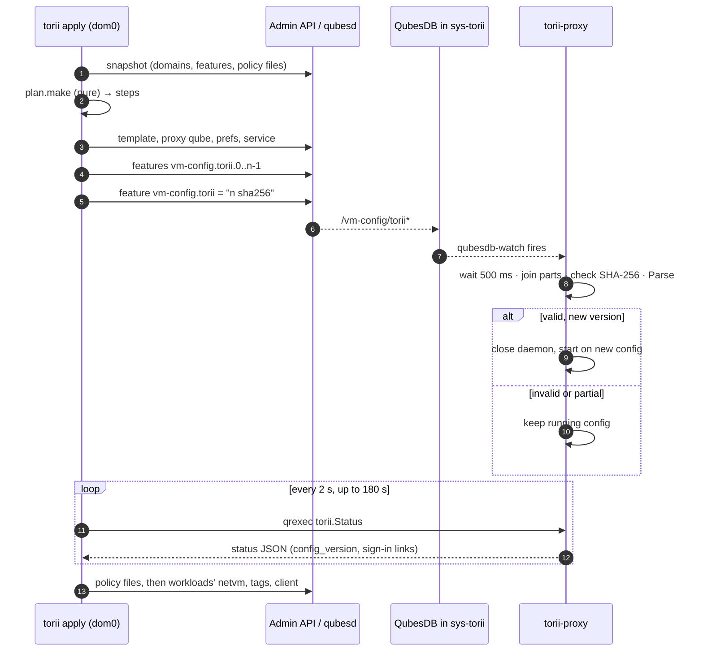

# plan, apply, show and check

How the dom0 tool turns `~/torii.yaml` into Admin API calls, how a proxy's
config crosses into the proxy qube and is taken atomically, and how
`show` and `check` reconstruct reach from the live machine. Components are
in [`architecture.md`](architecture.md); the rules are in
[`claims/apply.md`](../claims/apply.md) and
[`claims/seeing.md`](../claims/seeing.md).

<!-- charter:embed STK-261126-B4CP -->
> **[STK-261126-B4CP](../claims/needs.md#stk-261126-b4cp-torii-apply-must-change-only-what-torii-owns-and-must-make-exactly-the-steps-torii-plan-showed) torii apply MUST change only what torii owns, and MUST make exactly the steps torii plan showed**
>
> - `torii plan` MUST be a function of the machine file and a snapshot of
>   the live machine, and MUST list every change in the order apply makes
>   it. On a machine that matches the file, the plan MUST be empty.
> - `torii apply` MUST make those changes and no others, MUST stop at the
>   first change that fails, and, run again, MUST make only the changes
>   left.
> - torii owns its template, the proxy qubes it created, the policy file
>   `/etc/qubes/policy.d/50-torii.policy`, and, on each managed qube, only
>   its netvm, the `torii-client` service and feature, its torii tags and
>   the adoption features it writes once. torii MUST NOT create or delete
>   any other qube, and MUST NOT write any other policy file.
> - A qube removed from the file MUST be left with no netvm, never its old
>   one.
<!-- /charter:embed -->

The design constraint is that this code runs in dom0 with full control of
the machine. It is kept small and deterministic: a pure planner over a
snapshot, an executor that makes one Admin API change per step, and no
parsing of anything a qube sends except the status JSON.

Overview of one `torii apply` that changes a proxy's config:

## Parsing

[`cmd_plan`](../dom0/torii/cli.py#L74) and [`cmd_apply`](../dom0/torii/cli.py#L94)
call [`machine.load`](../dom0/torii/machine.py#L657), which reads the YAML and
builds a `Machine` in [`machine.parse`](../dom0/torii/machine.py#L551): unknown
keys, wrong types, invalid ports, undefined egresses and moved keys from
older formats are errors, collected for the whole file and raised before
the machine is touched ([SW-261127-9BNW](../claims/apply.md#sw-261127-9bnw-torii-must-read-the-machine-file-whole-and-must-refuse-it-whole-when-a-key-a-network-or-a-value-is-wrong)). Defaults are resolved per
qube, tags are expanded with the machine prefix
([`tags_of`](../dom0/torii/machine.py#L25), [SW-261127-P8H7](../claims/identity.md#sw-261127-p8h7-torii-must-give-a-tagged-identity-exactly-the-files-tags-prefixed-by-the-machine-and-torii-check-must-name-any-other)).

## Snapshot

[`live.take`](../dom0/torii/live.py#L83) reads, through `qubesadmin`, every
domain's class, power state, template, netvm (and whether it is the
default), `provides_network`, IP, label, tags and disposable settings;
features only for the domains the file names, the tool's own and their
templates, to bound the number of Admin API calls; and, through
`qrexec.policy.admin_client`, the text of every file in
`/etc/qubes/policy.d`. The result is a serializable
[`Snapshot`](../dom0/torii/live.py#L44); `torii snapshot` prints it, and the
plan tests in `dom0/tests` run against snapshots recorded on Qubes 4.3.

## Planning

[`plan.make`](../dom0/torii/plan.py#L96)`(machine, snapshot, bundle_version)`
is pure. It first collects every precondition failure and raises them
together (`PlanError`):

<!-- charter:embed SW-261127-2JH3 -->
> **[SW-261127-2JH3](../claims/apply.md#sw-261127-2jh3-torii-plan-must-refuse-before-any-step-a-file-that-names-what-this-machine-cannot-be-given) torii plan MUST refuse, before any step, a file that names what this machine cannot be given**
>
> `torii plan` is a function of the file and a snapshot of the live
> machine. It MUST refuse, planning nothing, when the file names:
>
> - a qube that does not exist, since torii never creates a workload;
> - one of torii's own qubes, a template or dom0 as a workload;
> - a netvm, or a qube another mesh manages, as a workload;
> - as a netvm, a qube that is not one;
> - a disposable template without `disposables: yes`, or `disposables:
>   yes` on a qube that is not a disposable template;
> - a qube whose current netvm torii does not know, without
>   `adopt: force`;
> - a routed qube with no fixed address, such as a disposable;
> - a `local-inbound` source, or a service's qube, that is not on the
>   machine or cannot host it;
> - a proxy whose netvm is not on the machine, or whose name a qube that
>   is not torii's, or another mesh's, already has.
>
> These MUST be named together. A template name that a qube not torii's
> already has, and a proxy to remove that a qube still uses, MUST each be
> refused on their own.
<!-- /charter:embed -->

The adoption checks are the ones that protect a machine torii did not
build: a qube on a netvm torii does not know (a Whonix gateway, a VPN
qube) is not moved without `adopt: force`, and a disposable template,
whose netvm every disposable inherits, is not listed without
`disposables: yes`.

It then emits typed `Step`s in a fixed order:

1. **Template.** `template-install` of the base, `clone` to the tool's
   template, `template-package` when its `torii-version` feature differs
   from the bundle's ([SW-261127-HSHY](../claims/apply.md#sw-261127-hshy-torii-must-install-the-proxy-package-from-the-dom0-packages-bundle-with-no-repository-for-torii)).
2. **Proxy qubes in use.** `restart` (new package, or a template move),
   `create`, `feature-set ipv6 ""` ([SW-261127-3Q23](../claims/apply.md#sw-261127-3q23-torii-plan-must-turn-ipv6-off-on-every-proxy-qube-for-itself-and-every-qube-behind-it)), prefs, the
   `torii-proxy` service, `proxy-config` with the chunked features from
   [`derive.proxy_config`](../dom0/torii/derive.py#L53) and
   [`derive.encode_chunks`](../dom0/torii/derive.py#L135), and `proxy-ready`.
3. **Policy.** `50-torii` (or `50-torii-<mesh>`) from
   [`derive.policy`](../dom0/torii/derive.py#L216), and the shared
   `59-torii-deny` from [`derive.deny_policy`](../dom0/torii/derive.py#L317)
   ([SW-261127-M36P](../claims/links.md#sw-261127-m36p-toriis-qrexec-policy-must-allow-only-calls-that-run-in-the-direction-of-the-connection-they-carry-and-only-those-the-file-declares), [SW-261127-KWT2](../claims/apply.md#sw-261127-kwt2-a-meshs-file-must-change-only-its-own-qubes-and-its-own-policy-file)).
4. **Workloads.** netvm, the `torii-managed` tag, on first adoption
   `torii-prior-netvm` and `torii-adopted`, and the `torii-client` service
   and `vm-config.torii-client` feature from
   [`derive.qube_state`](../dom0/torii/derive.py#L192).
5. **Workloads that left the file.** [`derive.reset_state`](../dom0/torii/derive.py#L208):
   netvm none, client service and feature removed, tag removed.
6. **Removals.** Proxy qubes the file no longer names (refused if any
   qube still uses one as netvm), then the tool's templates nothing uses.

Scope is enforced here, by construction of the step list:

<!-- charter:embed SW-261127-G26T -->
> **[SW-261127-G26T](../claims/apply.md#sw-261127-g26t-torii-apply-must-change-only-what-torii-owns-its-template-its-proxy-qubes-its-policy-files-and-named-settings-of-listed-qubes) torii apply MUST change only what torii owns: its template, its proxy qubes, its policy files, and named settings of listed qubes**
>
> - torii MUST create, change and remove only its own template, the proxy
>   qubes it created (tagged `torii-owned`, and with the mesh's tag for a
>   named mesh), its mesh's policy file `50-torii` (or `50-torii-<mesh>`)
>   and the shared deny file `59-torii-deny`.
> - torii MAY download the base template its own is cloned from, and MUST
>   NOT change it.
> - On a qube the file lists, torii MUST set only the netvm, the
>   `torii-client` service and its feature, the `torii-managed` tag and the
>   adoption features it writes once, and MUST remove the earlier
>   `torii-netvm-kept` tag.
> - Restarting a proxy detaches every running qube behind it and attaches
>   it again, listed or not.
> - torii MUST NOT create or remove a workload, and MUST NOT change a qube
>   that only hosts a service.
<!-- /charter:embed -->

Ordering is load-bearing. Proxies are configured and confirmed running
the new config (step 2) before the policy that lets workloads call them
and before any workload's netvm is pointed at them (steps 3 and 4).

The exit path from torii fails closed:

<!-- charter:embed SW-261127-VPGK -->
> **[SW-261127-VPGK](../claims/apply.md#sw-261127-vpgk-torii-must-record-an-adopted-qubes-netvm-once-and-must-leave-a-qube-that-leaves-the-file-with-no-netvm) torii MUST record an adopted qube's netvm once, and MUST leave a qube that leaves the file with no netvm**
>
> - The first apply that lists a qube MUST record the netvm it had, in
>   `torii-prior-netvm` and `torii-adopted`, and MUST NOT write them again.
> - A qube torii manages that the file no longer lists MUST be set to no
>   netvm, MUST lose the client's service and feature and the managed tag,
>   and MUST keep its record.
> - A qube still carrying the earlier `torii-netvm-kept` tag MUST keep the
>   netvm it has, since that netvm was never torii's to set.
> - When the record names a netvm other than none and other than the one
>   the qube has, plan MUST name it and the command to restore it, and
>   MUST NOT restore it.
<!-- /charter:embed -->

Restoring the prior netvm automatically would be the wrong default: a
qube that was routed through an egress or an allowlist would silently
regain direct, unfiltered access. `plan` names the prior netvm and the
`qvm-prefs` command; the owner decides.

[`plan.notes`](../dom0/torii/plan.py#L316) adds non-step output, such as a
workload on an egress whose LAN traffic is not routed through it
([SW-261127-KYZW](../claims/egress.md#sw-261127-kyzw-the-proxy-must-send-a-qubes-lan-traffic-directly-never-through-its-egress-and-torii-plan-must-say-so)) and a template that lacks the client package.

## Execution

`cmd_apply` does not execute a stored plan: it loads the file, takes a
fresh snapshot, re-plans, prints the steps and prompts (`-y` skips the
prompt; EOF on stdin is "no"). What is approved is what that invocation
computed; an earlier `torii plan` on a machine that changed since may
differ.

[`Applier.run`](../dom0/torii/apply.py#L45) dispatches each step to its
`do_<kind>` method:

<!-- charter:embed SW-261127-63CS -->
> **[SW-261127-63CS](../claims/apply.md#sw-261127-63cs-torii-apply-must-make-plans-steps-in-order-stop-at-the-first-failure-and-continue-on-the-next-run) torii apply MUST make plan's steps in order, stop at the first failure, and continue on the next run**
>
> `torii apply` MUST make plan's steps one at a time, in plan's order,
> naming each. The first step that fails MUST stop it, naming the step and
> the cause, and no later step is made. Run again, plan starts from the
> machine as the stopped run left it, so it holds only the steps not yet
> made; on a machine that matches the file it holds none.
<!-- /charter:embed -->

Idempotence follows from planning against the live state: every step is a
diff, so after a partial run the next plan contains only the remainder.

Mechanics worth knowing when reviewing `apply.py`:

- Qube changes are `qubesadmin` property, feature and tag writes; qubes
  are created with `add_new_vm` and cloned with `clone_vm`, and tagged
  `torii-owned` at creation, which is what later scope checks key on.
- `template-package` starts the template, runs as root over
  `qubes.VMRootShell`: the dependencies (`qubes-core-agent-networking`,
  `nftables`, `kmod`, `procps`) from the template's own repositories
  through the updates proxy, then the package bytes from the dom0 bundle
  piped to `/tmp`, `rpm -U --replacepkgs` or `dpkg -i`, and `systemctl
  enable` of the guard and the proxy; then shuts it down and records
  `torii-version`.
- `restart` detaches every running qube using the proxy as netvm, restarts
  it (moving its template if needed), records `torii-started-version`,
  and reattaches them in a `finally`. Reattachment sets the netvm
  explicitly, so a client that followed Qubes' default now has it set
  (TODO.md, "Later").
- `policy` is `policy_replace(name, text, token="any")`: an unconditional
  overwrite of the tool's own file, with no compare-and-swap against a
  concurrent hand edit of that file.

## Config delivery to the proxy

QubesDB refuses values of 3072 bytes or more, so
[`derive.encode_chunks`](../dom0/torii/derive.py#L135) serializes the config
as canonical JSON, gzips it (`mtime=0`, so the bytes are deterministic),
base64-encodes it and splits it into 2800-byte parts:
`vm-config.torii` holds `<parts> <sha256 of the JSON>`,
`vm-config.torii.0..n-1` the parts.
[`Applier.do_proxy_config`](../dom0/torii/apply.py#L166) writes the parts, then
the head, then deletes stale higher-numbered parts, so a reader at any
point sees either the old head, or a head whose hash does not match until
the last part lands.

In the proxy qube, `vm-config.*` features appear as `/vm-config/<key>` in
QubesDB, writable only from dom0's side (a qube can overwrite its own
copy; dom0's value stays). The program runs `qubesdb-watch`; on a change,
[`waitForNewConfig`](../proxy/cmd/torii-proxy/main.go#L165) waits 500 ms, then
[`qubesdb.Config`](../proxy/internal/qubesdb/qubesdb.go#L42) reads the head
and parts, decodes and checks the SHA-256, and `config.Parse` validates
the result:

<!-- charter:embed SW-261127-XGDY -->
> **[SW-261127-XGDY](../claims/apply.md#sw-261127-xgdy-a-proxy-must-take-its-config-whole-or-not-at-all-and-a-config-that-fails-a-check-must-not-replace-the-running-one) A proxy MUST take its config whole or not at all, and a config that fails a check MUST NOT replace the running one**
>
> - dom0 MUST hand each proxy its config as the features
>   `vm-config.torii*`: the JSON compressed, encoded and split into parts
>   under QubesDB's limit, with a head holding the part count and the
>   JSON's SHA-256.
> - apply MUST write the parts first and the head last, then remove stale
>   parts.
> - The proxy MUST join the parts, decode them, and check the hash and the
>   config itself. A config that fails any check MUST NOT be taken: the
>   proxy keeps running the config it has, or waits for a valid one if it
>   has none.
> - A valid config that the program then fails to start on ends the
>   process, and its service restarts it.
<!-- /charter:embed -->

A valid config with a new `version` replaces the running one in-process
([`run`](../proxy/cmd/torii-proxy/main.go#L89)): the daemon is closed and
started again, identities reconnect from their state directories without
a new sign-in, and open connections are dropped. The guard is not part of
this cycle and stays loaded throughout.

## Readiness

[`Applier.do_proxy_ready`](../dom0/torii/apply.py#L181) starts the proxy qube
if needed and polls `torii.Status` every 2 s
([`status.read`](../dom0/torii/status.py#L13):
`run_service("torii.Status", user="root")`, 15 s timeout per call) until `config_version` equals the
planned version, printing each new sign-in link it sees
([SW-261127-3TPX](../claims/identity.md#sw-261127-3tpx-an-identity-must-sign-in-by-a-link-a-person-approves-or-by-a-one-time-key-that-only-the-proxy-qube-keeps)), for up to 180 s:

<!-- charter:embed SW-261127-QMVP -->
> **[SW-261127-QMVP](../claims/apply.md#sw-261127-qmvp-torii-apply-must-not-go-past-a-proxys-config-until-the-proxy-reports-running-it) torii apply MUST NOT go past a proxy's config until the proxy reports running it**
>
> After writing a proxy's config, `torii apply` MUST start the proxy if it
> is not running, and MUST wait until the proxy's status reports that
> config's version, showing any sign-in links as they appear. If the proxy
> does not report the version in time, the step MUST fail, naming what the
> proxy last reported.
<!-- /charter:embed -->

## show

`cmd_show` takes a snapshot and each proxy's status and config, and
[`show.qube_view`](../dom0/torii/show.py#L97) derives reach from those alone.
Policy is evaluated by [`show.rules`](../dom0/torii/show.py#L39) over every
policy file, hand-written ones included, with qrexec's first-match
semantics:

<!-- charter:embed SW-261127-62WV -->
> **[SW-261127-62WV](../claims/seeing.md#sw-261127-62wv-torii-show-must-report-each-qubes-reach-from-the-live-machine-never-from-the-file) torii show MUST report each qube's reach from the live machine, never from the file**
>
> - `torii show` MUST read each qube's netvm and tags, every qrexec policy
>   file in dom0 (hand-written ones included), each proxy's config as its
>   features hold it, and each proxy's status. The machine file MUST only
>   choose which qubes are listed.
> - show MUST read a call as allowed the way qrexec reads policy, for exact
>   qube names and `@anyvm`:
>   - files in name order;
>   - the first rule for a source, the target asked for and an argument
>     decides;
>   - a rule for every service, `*`, counts for each service;
>   - a redirect reaches only its new target;
>   - `ask` is shown as reach on a prompt;
>   - an allow for every argument is shown as `*`.
> - Other tokens (`@tag:`, `@type:`, `@dispvm`) and included files are not
>   evaluated; `torii check` names the rules that use them.
> - A qube behind no proxy MUST be shown as reaching what its netvm allows.
<!-- /charter:embed -->

The file is read only to choose which qubes to list, so `show` reports
what the machine does, not what the file intends; tokens it does not
evaluate are reported by `check` rather than guessed at.

## check

[`show.check_problems`](../dom0/torii/show.py#L365) is `plan.make` with every
step reported as `drift:` and every `PlanError` as `file:`, plus checks a
plan cannot express:

<!-- charter:embed SW-261127-SMYC -->
> **[SW-261127-SMYC](../claims/seeing.md#sw-261127-smyc-torii-check-must-name-each-difference-it-looks-for-between-the-live-machine-and-the-file-and-must-fail-on-any) torii check MUST name each difference it looks for between the live machine and the file, and MUST fail on any**
>
> `torii check` MUST name, one line each:
>
> - every step plan would make (drift), and every reason plan refuses the
>   file;
> - a proxy whose config features cannot be read, that is not running,
>   that gives no status, or that runs another version than its features
>   hold;
> - an identity that is not running, with its sign-in link, or whose tags
>   differ from the file's;
> - an egress with no healthy exit node;
> - a qube attached to a proxy but not listed that was refused;
> - a disposable that can leave by its template's netvm;
> - in any policy file other than this mesh's own and the shared deny
>   file: a line allowing, or asking for, `torii.Connect`, `torii.Status`,
>   every service, or `qubes.ConnectTCP` from or to a listed qube, a proxy
>   or a token, marked when it uses a token check does not evaluate; and
>   every `!include`.
>
> check MUST exit 0 only when it names nothing. It does not read the qubes'
> firewall rules or the rules inside a proxy qube.
<!-- /charter:embed -->

The policy check is the one a security reviewer will care about: any
other file granting `torii.Connect`, `torii.Status`, `qubes.ConnectTCP` to
or from a managed qube or proxy, or a wildcard service, is named, so a
hand-written line cannot widen reach invisibly. It does not read the
qubes' firewall rules or the nftables state inside a proxy qube.

`torii log QUBE` prints the proxy's decision events for that workload
([SW-261127-R4CD](../claims/seeing.md#sw-261127-r4cd-the-proxy-must-log-every-connection-it-decides-with-the-verdict-and-the-rule-that-made-it)), over the same read-only service
([SW-261127-B8BM](../claims/seeing.md#sw-261127-b8bm-the-status-service-must-be-read-only-it-must-report-and-must-not-change-anything-in-the-proxy)).
