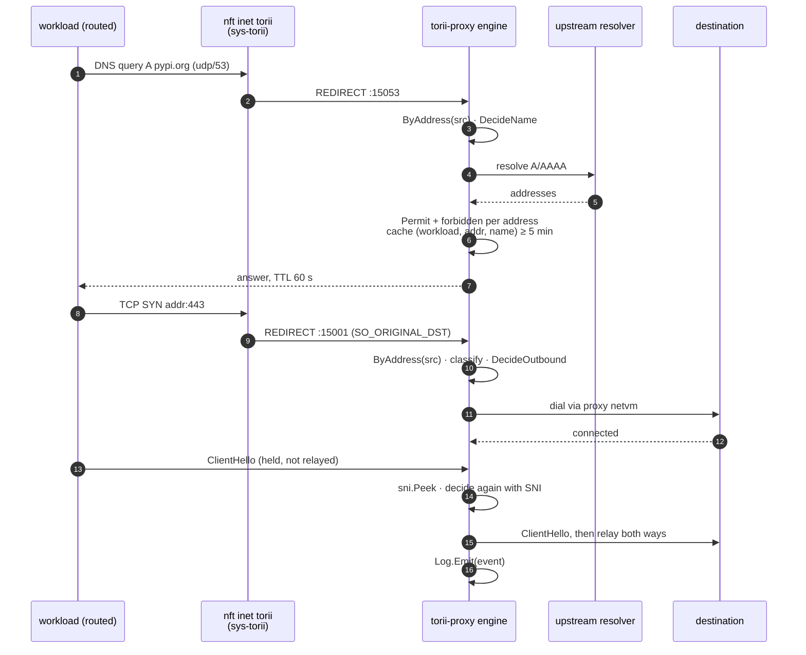
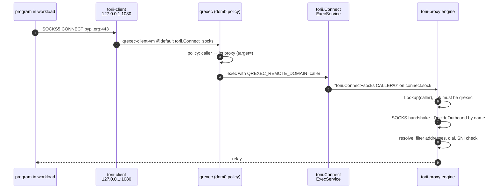

# Connection handling in torii-proxy

How `torii-proxy` authenticates the source of a connection, resolves and
authorizes its destination, dials it and relays it: for routed workloads
(nftables interception), for qrexec workloads (SOCKS5, HTTP proxy and
fixed forwards over `torii.Connect`), for UDP, and for inbound
connections from the tailnet. Components are described in
[`architecture.md`](architecture.md); the rules are in
[`claims/connections.md`](../claims/connections.md) and
[`claims/links.md`](../claims/links.md).

Terms. A *workload* (the code's word; the record's is *carried qube*,
[STK-261126-KZK8](../claims/needs.md#stk-261126-kzk8-torii-must-relay-a-carried-qubes-connection-only-if-the-qubes-entry-allows-it-and-must-refuse-every-other-connection)) is a qube whose traffic the proxy relays. Its
*link* is `routed` (the proxy qube is its netvm, `network: proxy`) or
`qrexec` (no netvm, `network: none`). The *zone* of a destination is a
function of the address dialled: tailnet, LAN or internet.

## Security properties of this path

The adversary is any code in the workload and any remote host it talks
to. Against it the proxy must:

- attribute each connection to a workload by a channel the workload
  cannot forge (Qubes' source-address anti-spoofing for routed workloads,
  dom0's naming of the qrexec caller for qrexec workloads);
- relay only to a destination the workload's entry allows, by zone,
  name or prefix, port and L4 protocol, with tailnet destinations also
  subject to the tailnet's grants;
- never reach another qube's Qubes address, the proxy qube's own sockets,
  loopback, link-local, multicast or the tailnet's ranges off-tailnet;
- fail closed: no packet is forwarded by the kernel, whatever state the
  program is in ([SW-261127-JWK2](../claims/links.md#sw-261127-jwk2-the-proxy-template-must-load-a-guard-at-boot-that-keeps-the-proxy-qube-forwarding-nothing-whatever-the-program-does)).

Stated non-goals: raw TCP or QUIC to another site behind an address an
allowed name shares; a connection that sends no TLS server name; DNS
exfiltration by a workload with `internet: all`
([STK-261126-KZK8](../claims/needs.md#stk-261126-kzk8-torii-must-relay-a-carried-qubes-connection-only-if-the-qubes-entry-allows-it-and-must-refuse-every-other-connection), the owner's answer to Q-261127-YZQC in [questions.md](../claims/questions.md)).

## Ingress, routed workloads

A routed workload's DNS lookup and TLS connection end to end; each step
is described in the sections below.

[`intercept.Install`](../proxy/internal/intercept/intercept.go#L74) loads
`table inet torii`, generated by
[`intercept.Rules`](../proxy/internal/intercept/intercept.go#L41), and writes 0 to
`/proc/sys/net/ipv4/ip_forward` and `/proc/sys/net/ipv6/conf/all/forwarding`. With the
default `-downstream vif*`:

| Chain (hook, priority) | Rule | Effect |
|---|---|---|
| `prerouting` (nat, dstnat − 10) | `udp dport 53`, `tcp dport 53` → `redirect to :15053` | all DNS to the program's resolver |
| | `meta l4proto tcp` → `redirect to :15001` | every TCP connection to the intercept listener |
| `mangle` (filter, mangle) | IPv4 `udp dport != 53` → `meta mark set 0x7173 tproxy ip to :15002` | other UDP to a transparent socket |
| `input` (filter, filter − 10) | accept established/related, 15001, 15053, marked UDP, ICMP; `counter drop` | nothing else from a workload reaches the proxy qube |
| `forward` (filter, filter − 10) | `policy drop` | |

Qubes' own `ip qubes` input chain rejects traffic from downstream to the
netvm itself, and an accept in another table does not override it, so
`Install` also adds its three accepts to `ip qubes custom-input`
([`QubesInputRules`](../proxy/internal/intercept/intercept.go#L353)), tagged
`comment "torii"` and replaced on each start. The boot-time guard
(`table inet torii-guard`, priority −400) is separate and independent of
this table: it drops all forwarding and all IPv6 from `vif*` before the
program has started and after it has died ([SW-261127-B6Z6](../claims/links.md#sw-261127-b6z6-the-proxy-qube-must-hand-every-routed-qubes-traffic-to-the-program-and-must-not-forward-any-of-it),
[SW-261127-JWK2](../claims/links.md#sw-261127-jwk2-the-proxy-template-must-load-a-guard-at-boot-that-keeps-the-proxy-qube-forwarding-nothing-whatever-the-program-does)).

[`intercept.ServeTCP`](../proxy/internal/intercept/intercept.go#L158) recovers
the pre-NAT destination with `SO_ORIGINAL_DST`
([`OriginalDst`](../proxy/internal/intercept/intercept.go#L112)) and calls
[`Engine.HandleIntercepted`](../proxy/internal/engine/engine.go#L779)`(src,
dst)`. A connection whose original destination is the intercept port
itself is handed on like any other, so the engine refuses and logs it.

**Source attribution.** [`Config.ByAddress`](../proxy/internal/config/config.go#L523)
maps the source IPv4 address to the workload whose Qubes address it is
([SW-261127-BHHX](../claims/links.md#sw-261127-bhhx-the-proxy-must-identify-a-routed-qube-by-its-qubes-source-address-which-qubes-keeps-it-from-forging)). Its soundness rests on Qubes' `antispoof` chain on
`vif*` dropping any source address but the qube's own, recorded as the
observation [QubesAntispoof](../claims/observations.md#qubesantispoof), not
yet confirmed by a probe. An address no entry has is the proxy's unlisted
source, decided by its `unlisted:` policy, refused by default.

## Ingress, qrexec workloads

In a workload with no netvm, `torii-client` listens on 127.0.0.1 only
(SOCKS5 on 1080, the HTTP proxy on 3128, one port per fixed forward),
and turns each accepted connection into one
`qrexec-client-vm @default torii.Connect+<arg>` with the TCP stream as
its stdio, `<arg>` being `socks`, `http` or `f.<name>`
([`serve`](../proxy/cmd/torii-client/main.go#L139), [SW-261127-N3N8](../claims/links.md#sw-261127-n3n8-torii-client-must-listen-on-loopback-only-and-must-make-one-qrexec-call-per-connection)).
dom0's policy routes `@default` to the workload's own proxy with
`target=` and allows nothing else ([SW-261127-M36P](../claims/links.md#sw-261127-m36p-toriis-qrexec-policy-must-allow-only-calls-that-run-in-the-direction-of-the-connection-they-carry-and-only-those-the-file-declares)).

In the proxy qube the service runs `torii-proxy connect-service`,
[`qrexec.ExecService`](../proxy/internal/qrexec/qrexec.go#L131): it takes the
caller from `QREXEC_REMOTE_DOMAIN`, which qrexec sets from dom0's view of
the call, validates it and the argument against fixed patterns, and
writes the header `torii.Connect+<arg> <caller>\0` to
`/run/torii/connect.sock` before splicing the stream.
[`Engine.HandleQrexec`](../proxy/internal/engine/engine.go#L534) looks the
caller up and refuses `wrong-entry` unless its link is `qrexec`:
[SW-261127-7C3Y](../claims/links.md#sw-261127-7c3y-the-proxy-must-take-a-qrexec-callers-identity-from-what-dom0-sets-never-from-what-the-caller-sends). No identifier the workload sends in-band is used for
attribution.

The same request from a qrexec workload:

The workload's own request then supplies the destination: a SOCKS5
`CONNECT` ([`socks5.Handshake`](../proxy/internal/socks5/socks5.go#L49), a 30 s
handshake deadline; a domain name is passed through, never resolved in
the workload), an HTTP request, or the forward's fixed `to:` from the
config ([`ForwardTarget`](../proxy/internal/policy/policy.go#L304)).

## DNS resolution, routed workloads

Queries redirected to :15053, over UDP or TCP, reach
[`Engine.AnswerDNS`](../proxy/internal/engine/engine.go#L807):

1. Source unknown: `REFUSED`. Unparseable with a question: `FORMERR`.
2. If the workload has an identity and the name is one of its tailnet's
   MagicDNS names, it is answered from the identity's netmap, subject to
   `outbound.tailnet` and its list.
3. Otherwise [`DecideName`](../proxy/internal/policy/policy.go#L243) checks
   whether any zone rule could allow the name (`all`, or a name entry
   matching it); if not, `NXDOMAIN`. On an egress with no healthy exit
   node, `SERVFAIL` ([SW-261127-HJNX](../claims/egress.md#sw-261127-hjnx-the-proxy-must-refuse-an-egresss-connections-at-once-and-fail-its-dns-while-the-egress-has-no-healthy-exit-node)).
4. A and AAAA are resolved upstream: by the proxy qube's resolver, or on
   the exit path by [`ExitResolver`](../proxy/internal/engine/engine.go#L267),
   DNS over TCP through the egress identity. An upstream failure other
   than NXDOMAIN is `SERVFAIL`. Other query types get an empty answer.
5. Each address is filtered by the zone it falls in, so a public name
   cannot rebind the workload to the LAN, another qube or the proxy qube:

<!-- charter:embed SW-261127-M7G9 -->
> **[SW-261127-M7G9](../claims/connections.md#sw-261127-m7g9-the-proxy-must-resolve-a-name-for-the-qube-and-for-itself-only-to-addresses-the-qube-may-reach-under-that-name) The proxy MUST resolve a name, for the qube and for itself, only to addresses the qube may reach under that name**
>
> - The proxy answers a routed qube's DNS. It MUST answer a name that the
>   entry allows in no zone with "no such name" (NXDOMAIN).
> - For an allowed name, the answer MUST hold only the addresses that the
>   entry allows under that name in their zone and that are not forbidden.
> - When the proxy resolves a name itself, for a qube with no netvm, it
>   MUST dial only the addresses that pass the same test.
<!-- /charter:embed -->

6. The answer goes out with a TTL of 60 s, whatever upstream gave, and the
   (workload, address, name) binding is recorded in
   [`dnsx.Cache`](../proxy/internal/dnsx/dnsx.go#L95) for at least
   [`nameMemory`](../proxy/internal/engine/engine.go#L84), 5 minutes.

That binding is what lets a later connection to a bare address be
authorized by name:

<!-- charter:embed SW-261127-2R9T -->
> **[SW-261127-2R9T](../claims/connections.md#sw-261127-2r9t-the-proxy-must-count-a-name-entry-only-for-a-name-the-qube-asked-for-or-resolved-through-the-proxy-to-the-address-dialled) The proxy MUST count a name entry only for a name the qube asked for, or resolved through the proxy to the address dialled**
>
> - A name entry MUST allow a connection only when the name it matches is
>   the name the qube asked for (through SOCKS, a forward or the HTTP
>   proxy), or a name the proxy's DNS resolved for that qube to the address
>   dialled.
> - The proxy MUST remember, per qube, each name it resolved and the
>   addresses it returned, for five minutes from the last answer, whatever
>   the answer's TTL.
> - The proxy MUST refuse a connection to an address that no name of the
>   qube's leads to and no address entry covers.
<!-- /charter:embed -->

Two consequences a reviewer should weigh. The binding authorizes the
address, not the site: for 5 minutes after resolving an allowed name, the
workload may open any connection on an allowed port to that address,
including one to another virtual host on a shared CDN address; only the
SNI check below narrows that for TLS. And a workload that hardcodes
addresses or uses DNS over HTTPS bypasses the resolver and so is refused
(`ip-not-resolved-by-workload`) on an allowlist.

## Authorization

The engine first classifies the destination
(`Engine.classify`: tailnet or not, by asking the workload's identity, and
the names the cache holds for the address), then calls
[`Engine.decide`](../proxy/internal/engine/engine.go#L202), which is the pure
[`DecideOutbound`](../proxy/internal/policy/policy.go#L131) plus two refusals
that need runtime state: the proxy qube's own addresses on the direct
path ([`Engine.forbidden`](../proxy/internal/engine/engine.go#L177)) and the
exit path while the egress is unusable
([`Engine.exitUsable`](../proxy/internal/engine/engine.go#L215)).

`DecideOutbound`, in order:

1. **Entry against link.** An intercepted connection is accepted only from
   a routed workload; SOCKS, HTTP and forwards only from a qrexec one, and
   SOCKS or HTTP only if declared: [SW-261127-PXX9](../claims/connections.md#sw-261127-pxx9-the-proxy-must-decide-a-connection-against-the-entry-of-the-qube-it-came-from-and-only-by-a-way-that-entry-offers). This prevents a
   routed workload from presenting itself through the qrexec door, or the
   reverse, to reach a different rule set.
2. **Tailnet.** Allowed only with `outbound.tailnet`; with a device list,
   the destination must match it by MagicDNS name, peer name or address.
   Where on the tailnet it may go is the grants'. Dialled only on the
   workload's own identity, never an egress's ([SW-261127-WSWG](../claims/identity.md#sw-261127-wswg-an-egresss-identity-must-carry-only-internet-traffic-and-torii-grants-must-propose-it-nothing-else)).
3. **Known address.** [`Permit`](../proxy/internal/policy/zone.go#L80) places
   it with [`ZoneOf`](../proxy/internal/policy/zone.go#L44):

<!-- charter:embed SW-261127-WNYB -->
> **[SW-261127-WNYB](../claims/connections.md#sw-261127-wnyb-the-proxy-must-place-every-address-in-exactly-one-zone-and-must-not-dial-a-forbidden-address) The proxy MUST place every address in exactly one zone and MUST NOT dial a forbidden address**
>
> - The proxy MUST place an address, in this order of precedence:
>   - in the tailnet zone if it is in 100.64.0.0/10 or fd7a:115c:a1e0::/48;
>   - otherwise in the forbidden zone if it is loopback, unspecified,
>     link-local, multicast, 255.255.255.255, in 0.0.0.0/8, or in Qubes'
>     own 10.137.0.0/16 to 10.139.0.0/16;
>   - otherwise in the LAN zone if it is in 10.0.0.0/8, 172.16.0.0/12,
>     192.168.0.0/16 or fc00::/7;
>   - otherwise in the internet zone.
> - The proxy MUST decide a connection by the zone of the address it
>   dials, never by the name the qube used.
> - The proxy MUST refuse a forbidden address whatever the file says.
> - On the direct path, the proxy MUST also refuse any of the proxy qube's
>   own addresses. Through an exit node those addresses belong to the exit
>   node's network and are not refused.
<!-- /charter:embed -->

   then applies the zone's rule (`none`, `all`, or a list). A prefix entry
   matches by address; a name entry only through a name the workload asked
   for or resolved; and a server name, when one was sent, must match a
   name entry too. Matching ([`Match`](../proxy/internal/policy/policy.go#L221)):

<!-- charter:embed SW-261127-2XS6 -->
> **[SW-261127-2XS6](../claims/connections.md#sw-261127-2xs6-the-proxy-must-match-an-allow-entry-by-exact-name-or-subdomain-port-and-protocol-treating-an-entry-without-a-protocol-as-tcp-only) The proxy MUST match an allow entry by exact name or subdomain, port and protocol, treating an entry without a protocol as TCP only**
>
> - `example.com` MUST match that name alone; `*.example.com` MUST match
>   every name under it and MUST NOT match `example.com` itself.
> - Names MUST compare case-insensitively and without a trailing dot.
> - An address or range entry MUST match the address dialled, whatever the
>   names.
> - An entry without a port MUST match every port.
> - An entry without a protocol MUST match TCP only; UDP MUST need `/udp`.
<!-- /charter:embed -->

4. **Name only** (SOCKS, HTTP or a forward with a hostname, before it is
   resolved): allowed if some zone could allow the name; the addresses it
   resolves to are decided again at dial time.

The reasons a refusal carries are the `Reason` constants in
[policy.go](../proxy/internal/policy/policy.go); the common ones are
`not-allowlisted`, `ip-not-resolved-by-workload`,
`server-name-not-allowlisted`, `server-name-unreadable`, `no-internet`,
`no-lan`, `forbidden-address`, `no-tailnet-outbound`, `wrong-entry` and
`egress-no-healthy-exit`.

## Dial

[`Engine.dial`](../proxy/internal/engine/engine.go#L659) selects the transport
by the decision's path ([`PathFor`](../proxy/internal/policy/zone.go#L166)):
the proxy qube's own network stack (so its netvm) for internet and LAN,
the workload identity's tsnet netstack for the tailnet, the egress
identity's for the exit path ([`walkthrough-egress.md`](walkthrough-egress.md)).
A hostname the proxy resolves itself is resolved, each address filtered
exactly as a DNS answer is, IPv4 tried first, within the 15 s dial
timeout. The address actually dialled is written back into the request,
so the SNI decision that follows is made against the zone really reached,
not the one the name suggested.

## SNI check before relay

When the workload's applicable rule is an allowlist (internet or LAN, or
a tailnet device list), [`Engine.carry`](../proxy/internal/engine/engine.go#L741)
relays through `relayChecked`: server-to-client bytes flow at once, so a
server-first protocol works; client-to-server bytes are held until
[`sni.Peek`](../proxy/internal/sni/sni.go#L40) has classified the first
record:

<!-- charter:embed SW-261127-6S2F -->
> **[SW-261127-6S2F](../claims/connections.md#sw-261127-6s2f-the-proxy-must-check-an-allowlisted-connections-tls-server-name-before-relaying-any-of-the-clients-bytes) The proxy MUST check an allowlisted connection's TLS server name before relaying any of the client's bytes**
>
> - When a zone of the qube's entry is an allowlist, the proxy MUST hold
>   the client's bytes until it has read the client's first bytes. It MAY
>   relay the server's bytes meanwhile.
> - Unless an address entry allowed the connection, a ClientHello's server
>   name MUST match a name entry of the zone reached, including the entry's
>   port and protocol.
> - On the tailnet, when the device behind the address is known, the
>   server name MUST also name that device.
> - The proxy MUST refuse a TLS record from which no ClientHello can be
>   read within two seconds of its first byte.
> - A connection that is not TLS, or a ClientHello with no server name, is
>   decided on the names alone.
<!-- /charter:embed -->

`Peek` reads with no deadline until the client's first byte, so pausing
before the ClientHello does not skip the check; after that byte the whole
ClientHello must arrive within 2 s (`SNIWait`). A record starting `0x16
0x03` is handed to `crypto/tls` through `GetConfigForClient`, which
captures `ClientHelloInfo.ServerName` and aborts the handshake, so
fragmentation across records or segments does not hide the name; nothing
is written to the client. A TLS record from which no ClientHello parses
in time is refused (`server-name-unreadable`); anything else is "no server
name". With a name, the request is decided again; the peeked bytes are
then sent upstream first.

Residual risk, as stated in the record: a client that sends no SNI, or a
non-TLS protocol, is decided on the names alone; only the cleartext
`server_name` is read, so with ECH it is the outer, public name; and an
HTTP `Host` inside the TLS stream that differs from the SNI (classic
domain fronting) is not seen.

## HTTP proxy

`CONNECT host:port` is decided by name like SOCKS and relayed with the
same SNI check ([`Engine.httpConnect`](../proxy/internal/engine/http.go#L53));
a refusal is `403` with the reason in the body, an unreachable
destination `502`. Plain HTTP must be absolute-form `http://`; the first
request's host and port are pinned for the connection, each request is
re-serialized with that `Host`, and a request for any other is refused
`http-host-changed` and ends it
([`Engine.httpForward`](../proxy/internal/engine/http.go#L97)):
[SW-261127-H3W9](../claims/connections.md#sw-261127-h3w9-the-proxys-http-proxy-must-carry-only-one-host-and-port-per-connection). Unlike intercepted plain HTTP, this path therefore
cannot be used to reach another virtual host on a shared address.

## UDP

Non-DNS IPv4 UDP from routed workloads arrives on the TPROXY socket.
[`Engine.HandleUDP`](../proxy/internal/engine/udp.go#L69) keys flows on
(source, original destination); the first datagram of a flow is decided
like a TCP connection with protocol `udp`, and the rest follow that
verdict until 60 s of idleness (`UDPIdle`). Replies are sent from a
transparent socket bound to the original destination, so the workload
sees the real peer address. Each workload may hold at most 512 flows
(`MaxUDPFlows`), refused flows included, so a workload cannot exhaust the
proxy's sockets or conntrack by spraying destinations:
[SW-261127-QQYS](../claims/connections.md#sw-261127-qqys-the-proxy-must-decide-udp-once-per-flow-and-must-cap-each-qubes-open-flows). An allowlist entry applies to UDP only with `/udp`;
QUIC's server name is not read. IPv6 UDP is dropped by the guard. SOCKS
`UDP ASSOCIATE` is not implemented; a qrexec workload has no UDP.

## Inbound

Each identity listens, in its own tsnet netstack, only on the ports its
entry or a service declares ([`Engine.Start`](../proxy/internal/engine/engine.go#L286),
`ListenTLS` when the port has `tls: yes`, terminating HTTPS with the
device's own certificate). Per connection,
[`Engine.handleInbound`](../proxy/internal/engine/engine.go#L482) records the
peer from `WhoIs`, re-checks the port with
[`DecideInbound`](../proxy/internal/policy/policy.go#L290) and dials the
workload by `qrexec-client-vm <qube> qubes.ConnectTCP+<target port>`, for
routed workloads too, since a Qubes app qube's own firewall drops new
connections from its netvm:

<!-- charter:embed SW-261127-T7GG -->
> **[SW-261127-T7GG](../claims/connections.md#sw-261127-t7gg-the-proxy-must-relay-an-inbound-connection-to-a-qube-only-on-a-port-its-entry-or-a-service-lists) The proxy MUST relay an inbound connection to a qube only on a port its entry or a service lists**
>
> - The proxy MUST relay a connection arriving at a qube's tailnet
>   identity only when its port is one that the entry's `tailnet.inbound`
>   or a service lists, and MUST send it to the qube's port mapped behind
>   it.
> - An identity MUST NOT listen on any other port, so a connection to one
>   is refused.
> - Who on the tailnet may connect at all is decided by the grants.
<!-- /charter:embed -->

Authorization of the remote peer is the tailnet's: a port declared but
not granted is dropped by the identity's Tailscale packet filter, built
from the grants in its netmap, before tsnet's listener sees it. torii only
proposes the grants ([SW-261127-DH6R](../claims/identity.md#sw-261127-dh6r-torii-must-only-propose-grants-for-the-tailnet-and-must-not-change-the-tailnets-policy)). Connections between qubes on
the same machine do not go through the proxy at all: `local-inbound` is a
dom0 policy line for `qubes.ConnectTCP`, and other qubes' addresses are in
the forbidden zone.

## Decision log and explain

Every decision, at every step above, is one
[`events.Event`](../proxy/internal/events/events.go#L27): time, workload,
direction, entry, network, source (a qube or a tailnet peer), destination
as asked, SNI, verdict, reason, path, identity, the name the decision
rested on, and the dial error if an allowed connection failed. `fill`
copies the decision into it and
[`Log.Emit`](../proxy/internal/events/events.go#L61) keeps a per-workload
ring and, with a log directory, a JSONL file per workload:
[SW-261127-R4CD](../claims/seeing.md#sw-261127-r4cd-the-proxy-must-log-every-connection-it-decides-with-the-verdict-and-the-rule-that-made-it). dom0's `torii log QUBE` reads the ring over
`torii.Status`.

`torii-proxy explain -workload Q -dest host:port [-sni NAME] [-direction
in]`, run in the proxy qube against `/run/torii/admin.sock`, evaluates
[`Engine.Explain`](../proxy/internal/engine/engine.go#L903) with the same entry
the workload's link would use, the egress's health and the proxy's own
addresses, and dials nothing. It does not resolve names, so a name can
explain as allowed whose every address the dial would refuse:
[SW-261127-Z5ST](../claims/seeing.md#sw-261127-z5st-explain-must-give-the-decision-the-proxy-would-make-now-without-sending-anything). dom0 has no command for it; `torii.Status` carries
status and the log only.
